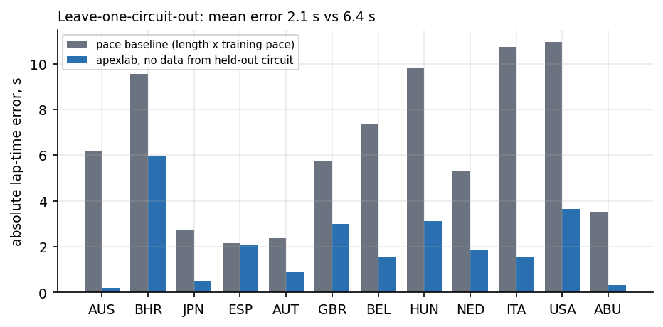
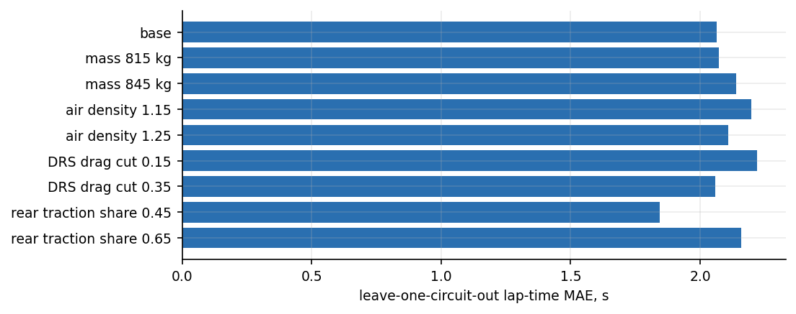
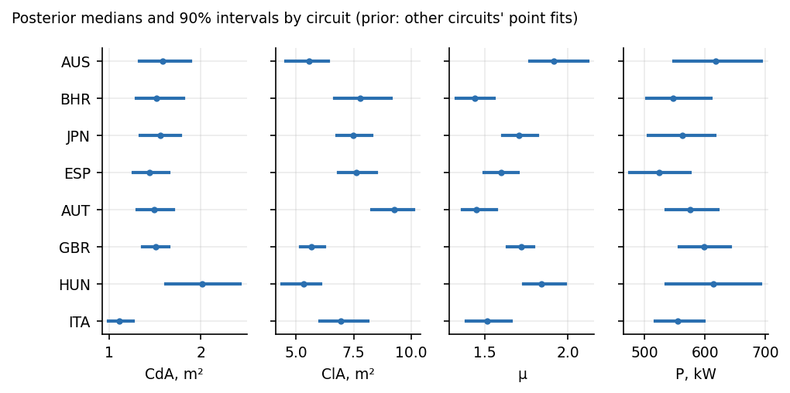
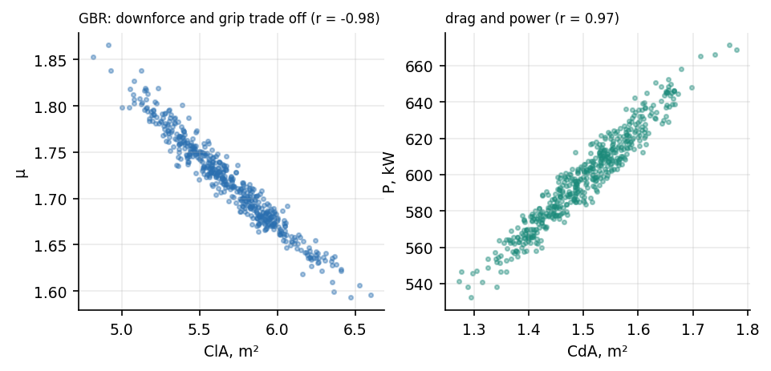
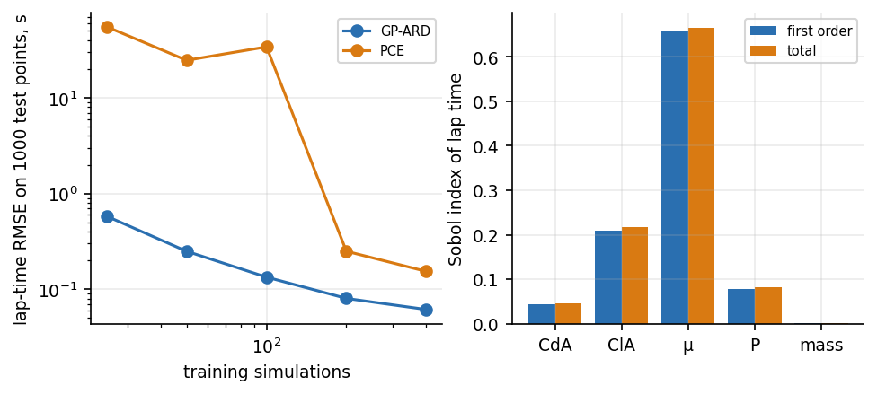
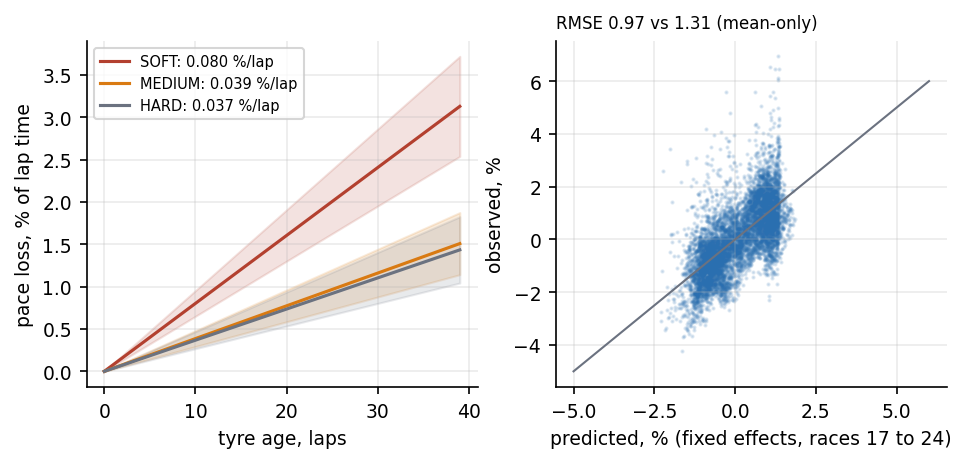

# 1. Summary

apexlab is a small, tested Python toolkit that does five things with public 2025 Formula 1 data. (1) It builds a differentiable quasi-steady-state point-mass lap-time simulation and checks it against closed-form answers. (2) It identifies four effective car parameters (drag area CdA, downforce area ClA, tyre friction coefficient μ and drive power P) from measured speed traces at 12 circuits. (3) It puts Bayesian posteriors on those parameters at 8 of the 12 circuits (the other four were not run) and checks the intervals on laps they did not see. (4) It builds Gaussian-process, polynomial-chaos and POD reduced-order surrogates of the simulator and runs Sobol sensitivity analysis. (5) It fits a mixed-effects tyre-degradation model to 20,821 clean race laps and tests it on later races.

Headline results, each with the test that produced it:

- **Speed traces.** On the lap used for fitting, the simulated speed differs from the measured speed by 3.4 m/s RMS on average over the 12 circuits (12 km/h), and the simulated lap time is 0.17 s too fast on average (mean absolute error 0.20 s). On the other four fast laps at the same circuit, which were driven by other drivers, the speed error is 3.4 m/s and the simulated lap is 0.49 s faster than the measured one on average.
- **Unseen circuits.** Predicting a circuit with the median parameters of the other eleven (no data from that circuit) gives a mean absolute lap-time error of **2.1 s**, against 6.4 s for a model-free baseline (circuit length times the pace of the other circuits). The worst case is Bahrain at 6.0 s; the best is Australia at 0.2 s.
- **Assumptions.** Refitting under eight alternative fixed assumptions (mass, air density, DRS drag cut, rear traction share) moves that 2.1 s between 1.8 and 2.2 s. The conclusion does not depend on any single assumed constant, although the fitted parameters do move (for example CdA between 1.27 and 1.57 m²).
- **Surrogates.** A Gaussian process with ARD kernel reproduces simulated lap time with 0.06 s RMSE from 400 training simulations (0.25 s from 50). Sobol indices from the polynomial-chaos coefficients agree with Saltelli sampling on 14,336 direct simulations to within 0.003.
- **Tyres.** Soft tyres lose 0.080 % of lap time per lap of tyre age (95% interval 0.065 to 0.095), medium 0.039 % and hard 0.037 %. Trained on the first 16 races, the model predicts the last 8 with 0.97 % RMSE against 1.31 % for a mean-only baseline.

What this is not: there is no wind-tunnel, CFD, rig or team data here, and none is claimed. The parameters are *effective* values that absorb everything a point mass leaves out, and I treat them as such throughout. I have no Formula 1 experience. The code was written with an AI coding assistant (Claude); every number in this report comes from code in the repository and can be regenerated.

# 2. Data and provenance

All data are per-lap telemetry and lap tables for the 2025 season from the public repository TracingInsights/2025 (Apache-2.0 code; the underlying timing data are for personal, non-commercial use; the repository is unofficial and not associated with the Formula 1 companies). `apexlab.fetch` downloads 1,006 timing files (958 per-driver lap tables and 48 driver lists for the 24 race and 24 qualifying sessions) and records a SHA-256 for each in `data/MANIFEST.json`. Raw files are not redistributed here; the script fetches them.

Each telemetry lap has about 600 to 700 samples at an irregular interval (median 0.13 s) with 17 data channels, of which this project uses time, speed, throttle, brake, DRS flag, gear and the x, y position. Two facts about the data were established by measurement, because getting them wrong silently ruins the geometry: the position channels are in tenths of a metre (the path length is 10.0 times the integrated speed distance), and the integrated-speed distance agrees with the spline arc length to between 0 and 1.5 %. Twelve circuits with unchanged layouts across the season were used for identification (AUS, BHR, JPN, ESP, AUT, GBR, BEL, HUN, NED, ITA, USA, ABU); for each, the five fastest valid qualifying laps, at most one per driver, were taken (timing-accurate, not deleted, not an in or out lap).

# 3. The simulator and how it is verified

The car is a point mass of mass $m$ on a line of curvature $\kappa(s)$. At each point the tyres can supply a total force $\mu N$ with normal load $N = mg + \tfrac12 \rho\, C_lA\, v^2$ (friction ellipse). Following the line needs lateral force $m v^2 \kappa$, so the force left for driving or braking is $\sqrt{(\mu N)^2 - (m v^2\kappa)^2}$. Drive force is $\min(P/v,\; k\,F_x)$ with $k = 0.55$ the share of the grip available to the driven axle; resistance is $\tfrac12\rho\, C_dA\,(1 - 0.25\,d)\,v^2 + c_{rr} m g$ where $d$ is the measured DRS flag. The speed profile is the minimum of the cornering limit, a backward braking scan and a forward traction scan over two concatenated laps (so the loop is closed). The code is JAX, jit-compiled and differentiable; one lap takes about 0.4 ms.

Fixed assumptions, all labelled as such: mass 830 kg (800 kg minimum plus a light qualifying fuel load), air density 1.20 kg/m³, rolling resistance 0.010, traction share 0.55, DRS drag cut 25 %. None was tuned on the evaluation laps. The sensitivity of the conclusions to each is in section 5.

Not modelled: load transfer, tyre temperature and wear, suspension and kerbs, gear shifts, ERS deployment (power is one effective constant), banking, wind and the driver. These are the reason the fitted parameters are effective and the reason the residuals in section 5 are not noise.

Verification is against closed-form solutions, not against another simulator (I did not install and run the TUM lap-time simulator, which would be the natural cross-check). The 12 tests (7 on the simulator and geometry, 5 on the DRS term, surrogates and tyre filter): (i) the top speed on a long straight equals the root of $P/v = \tfrac12\rho C_dA v^2 + c_{rr}mg$ to 1 %; (ii) on a constant-radius circle without drag the simulated speed and lap time equal $v^2 = \mu m g/(m/R - \mu\,\tfrac12\rho C_lA)$ to 1 % for three radius and downforce cases, and with drag the speed stays between 0.9 and 1.0 of that limit; (iii) braking at constant deceleration $(\mu + c_{rr})g$ matches the closed-form distance; (iv) traction-limited acceleration equals $kμg - c_{rr}g$; (v) lap time falls with more power, downforce and grip and rises with more drag; (vi) lateral acceleration never exceeds tyre capacity on a varying-curvature track; (vii) the curvature estimator recovers a circle; then (viii) opening DRS makes a straight faster and a closed flag changes nothing; (ix) the Latin hypercube is in range and stratified; (x) polynomial chaos recovers a known polynomial and its exact Sobol indices; (xi) POD reconstructs a low-rank field; (xii) the tyre filter drops pit laps, lap 1 and slow laps.

# 4. Geometry from the driven line

The simulator needs curvature along the lap. I take it from the driven line itself: the x, y of the five fastest laps are averaged on normalised distance (cutting position noise by about $\sqrt5$), fitted with a periodic smoothing spline, and curvature is sampled every 5 m, median-filtered and lightly smoothed. The curvature belongs to the line the cars drove, which is what a point mass needs, not the centreline.

This step needed care. My first setting (spline smoothing 2 m, 15 m curvature smoothing) flattened tight corners: at Monza the largest curvature came out as 0.019 m⁻¹ (radius 53 m) and the simulation ran 16 to 19 m/s too fast on average in the slowest corners (the chicanes). I changed the setting (0.3 m, 7-point median, 10 m smoothing) after comparing speed errors on the pole lap of **three circuits (ITA, GBR, HUN)**, which cut speed RMSE at those three from 4.3 to 7.0 m/s down to 2.4 to 3.3 m/s. The same setting was then applied unchanged to the other nine circuits. This is a mild form of tuning on fitted data, and I say so. The weak point is robustness: the spline needs position noise below about 0.3 m; at 0.5 m curvature blows up (recorded in the test's docstring), so the method depends on the five-lap averaging.

# 5. Parameter identification and validation

For each circuit, CdA, ClA, μ and P are fitted by bounded least squares (log parameters, JAX Jacobians) to the speed trace of the pole lap, thinned to 50 m, plus the lap time. Three validations follow.

**Other drivers' laps.** Laps 2 to 5 at the same circuit use the pole-lap parameters. Mean speed RMSE is 3.4 m/s, equal to the fit lap (3.4 m/s), and the simulated lap is 0.49 s faster than measured, which is the pole lap being faster than the others, not a model failure. This test is weak (same car class, same track, same conditions) and I report it only for completeness.

**Unseen circuits (leave-one-circuit-out).** The held-out circuit gets the median of the other eleven point fits and no calibration. The mean absolute lap-time error is 2.06 s against 6.37 s for the pace baseline. The model beats the baseline at all 12 circuits, at Barcelona only barely (2.10 against 2.16 s). The worst case is Bahrain (5.95 s too fast, where its own fit is within 0.2 s), so a median-parameter prediction is not a substitute for calibration, and the 2 s figure is an average over a spread of 0.2 to 6.0 s.

**Assumptions.** Section 3's fixed constants were each varied and everything refitted.

The range of the headline error is 1.85 to 2.22 s. The lowest value (1.85 s) is at a traction share of 0.45 rather than the 0.55 I fixed beforehand; I did not select the share by this result and the difference is within the spread of the other variants.

**Identifiability.** Six of the twelve point fits sit on the ClA upper bound (7 m²) and a seventh (Monza, 6.97 m²) is just below it. Fitted μ (1.5 to 2.7) and ClA trade against each other. These are not tyre and aero coefficients in any physical sense: a point mass with no load transfer and no ERS model must choose whatever (ClA, μ, P) reproduces the speed trace, and the data cannot separate downforce from grip. The Bayesian section quantifies that trade-off.

# 6. Bayesian posteriors and what they can and cannot say

I sampled the posterior of (CdA, ClA, μ, P) with NUTS in NumPyro, two chains of 250 draws each after 200 warm-up, for 8 of the 12 circuits (BHR, ESP, GBR, HUN, ITA, JPN, AUT, AUS). The other 4 (BEL, NED, USA, ABU) were not run: I stopped the job to save time, so this section covers 8 circuits, not 12. The prior for a circuit is log-normal with the mean and standard deviation (floored at 0.2) of the log point-fits of the *other* circuits: an empirical-Bayes choice. A fully hierarchical model over all 12 circuits was tried first; it cost 0.1 s per gradient and about 45 minutes per chain, so I did not run it. The likelihood is the thinned speed trace of the pole lap with a learned scale σ_v and the lap times of the three fastest laps with a learned scale σ_t. The maximum tree depth was 10 for AUS, BHR, ESP, GBR, HUN and ITA and 8 for JPN and AUT (the first attempt at JPN had not finished after 15 minutes).

**Sampler health.** JPN did not mix (R-hat 1.06, effective sample size 13) and its posterior should be disregarded; the other 7 have R-hat at most 1.03 and effective sample size at least 96. Across all 8 there were 47 divergent transitions in 4000 draws (24 at most in one circuit). Effective sample sizes of about 100 to 250 are modest, so the intervals are indicative, not precise.

**What the posteriors say.** ClA and μ are almost perfectly anti-correlated (correlation of logs -0.98, range -0.99 to -0.98): the data fix a combination of downforce and grip and not the two separately, which is the practical meaning of "effective parameters". The posterior medians of ClA run from 5.3 to 9.3 m², above the 7 m² bound used in the point fits at several circuits (the prior comes from point fits that sit on that bound). I would not read those values as physical downforce. The 90% intervals on ClA are 18% to 33% of the median wide, which is narrow compared with the spread between circuits and therefore overstates what the data know (see the next paragraph).

**Is the interval honest?** Only partly. Each posterior predicts the lap times of laps 4 and 5 of the five fastest (parameter uncertainty plus the learned σ_t), which it never saw. Across 16 held-out laps (8 circuits, two laps each) the nominal 90% interval contained the observed time 88% of the time (the misses are both laps at JPN, the circuit that did not mix) and the nominal 50% interval only 19%. The 50% result is poor and has a clear cause: the laps are ordered fastest first, so laps 4 and 5 are slower than the laps used for training, and the observed time lies above the predictive median in 16 of 16 cases. The interval is centred on the pole-lap pace and is not widened for that offset. The mean 90% width is 1.65 s, of which parameter uncertainty alone is 0.73 s. The speed residuals are strongly autocorrelated, so the likelihood overstates the information; 16 laps is a small test and the coverage figures carry wide sampling error.

# 7. Surrogates, reduced-order model and sensitivity

Inputs were sampled over CdA 0.9 to 1.9 m², ClA 2 to 7 m², μ 1.2 to 2.6, P 400 to 750 kW and mass 800 to 860 kg by Latin hypercube. Surrogates were scored on 1,000 independent test simulations at three circuits (ITA, GBR, HUN).

The Gaussian process (ARD Matérn-5/2) reaches 0.25 s RMSE at 50 training simulations and 0.06 s at 400. Polynomial chaos of total degree 4 has 126 coefficients, so it is under-determined below that many points: at 25 to 100 simulations it is unusable (RMSE 25 to 55 s) and at 200 and 400 it reaches 0.25 s and 0.15 s. I report the failures because they are the practical rule: use a lower degree or a GP when simulations are scarce.

The POD reduced-order model of the speed trace keeps 99.6 to 99.7 % of the variance in 8 modes and predicts lap time to 0.004 to 0.012 s. It does **not** predict the speed trace well pointwise: the RMSE stalls near 0.9 to 1.4 m/s however many modes are used and the worst point is 15 to 44 m/s off, because the trace has sharp kinks where the active constraint switches (grip-limited, power-limited, braking), which a smooth polynomial in the parameters cannot follow. Lap time, an integral, hides this.

Sensitivity of lap time over these ranges, from Saltelli sampling with 14,336 simulations per circuit: μ explains 57 to 76 % of the variance (first order), ClA 20 to 23 %, power 2 to 14 %, CdA 1 to 8 % and mass below 0.2 %. Interactions are small (total minus first order is under 0.03 everywhere). The PCE-analytic indices agree with the sampled ones within 0.003, well inside the sampled indices' 95% bootstrap intervals (half-widths up to 0.05), which is the check that both are right. The ordering follows the circuit: power and drag matter most at Monza and least at the Hungaroring.

**Speed-up.** The direct simulation takes 0.43 to 0.49 ms per lap; the GP takes 0.012 to 0.025 ms and the PCE 0.003 to 0.009 ms per prediction. These are real timings, and they show that for this simulator surrogates buy a factor of about 20 to 160 at lap-time errors of 0.06 to 0.25 s on a quantity that is already cheap. The workflow, the error measurement and the failure modes are what carry over to a model that costs seconds or hours per run; the speed-up does not.

# 8. Tyre degradation from race laps

Clean laps (timing-accurate, green, not deleted, no in or out lap, not lap 1, within 107 % of the event median) from all 24 races give 20,821 laps in 1,039 driver-stints. The response is lap time as a percentage of the event median. Fixed effects are race progress (a fuel and track-evolution proxy), tyre age by compound and track temperature; each driver-stint has a random intercept and a random tyre-age slope (statsmodels MixedLM).

Degradation is 0.080 %/lap for softs (0.065 to 0.095), 0.039 for mediums (0.029 to 0.048) and 0.037 for hards (0.027 to 0.047); medium and hard are not distinguishable, and softs are about twice as fast. On a 90 s lap that is 0.07, 0.035 and 0.033 s per lap. Race progress carries a −3.5 % effect over a race, which is fuel burn plus track evolution plus anything else that changes with time; the two cannot be separated here. Track temperature has no detectable effect once the event median is removed (−0.003 %/°C, interval −0.028 to 0.022).

On the chronological test (train on races 1 to 16, predict 17 to 24 using population-level effects only, since a new race's driver-stint effects are unknown) the RMSE is 0.97 % against 1.31 % for a mean-only baseline. The nominal 90 % predictive interval covered 98 % of test laps and the 50 % interval covered 72 %, so the intervals are too wide: the random-intercept variance (2.9) is dominated by differences between drivers and cars that a new-race forecast cannot know but that the training average overstates in later races. I report the miscalibration instead of rescaling the intervals to fit.

Link to the simulator: the derivative of simulated lap time with respect to μ at the median fitted parameters is −0.35 to −0.49 % of lap time per 1 % of μ at ITA, GBR and HUN. Read through that model, soft-tyre degradation corresponds to an equivalent grip loss of 0.16 to 0.23 % per lap and mediums or hards about 0.08 to 0.11 %. This is a conversion through an effective parameter, not a measurement of tyre grip: drivers manage pace, traffic costs time, and none of that is in the data.

# 9. Limitations

- The simulator is a point mass; the fitted parameters are effective. Six of twelve ClA fits hit their bound and a seventh is just below it, and ClA and μ trade against each other.
- Verification is against closed-form solutions only. It has not been cross-checked against another lap-time simulator.
- The geometry setting was chosen on three circuits' fit quality, then applied to all twelve.
- Qualifying laps are used for identification; ERS and fuel loads are not known, and the mass is an assumption.
- Leave-one-circuit-out error ranges from 0.2 to 6.0 s; the average hides a poor case (Bahrain).
- Residuals are strongly autocorrelated, so posterior intervals describe parameter uncertainty under a misspecified model. They are checked empirically on held-out laps, not assumed.
- The tyre model has no traffic or gap data, no fuel mass and no driver pace management; the fuel effect is confounded with track evolution.
- Posteriors exist for 8 of 12 circuits, and one of the 8 (JPN) did not mix. The ClA and μ posteriors are almost perfectly anti-correlated, and the 50% predictive interval covered only 19% of held-out laps because later laps are slower than the pole lap.
- The empirical-Bayes priors use the other circuits' point fits, several of which sit on a bound. The posterior can therefore put ClA above the point-fit bound.

# 10. Reproducing this

`pip install -e ".[dev]"`, `pytest` (12 tests), then `python scripts/run_all.py`. Order: fetch, point fits and validation, Bayesian fits (about 1 to 1.5 hours on 2 CPUs for all 12; the delivered results cover 8), surrogates and Sobol, tyres, assumption sensitivity, figures. The code is in `src/apexlab` (fetch, laps, geometry, physics, circuits, ident, validate, bayes, surrogate, tyres), the scripts in `scripts/`, and all tables in `outputs/tables/`.

The project was built with an AI coding assistant, as stated above. It claims no team data, no CFD, no wind-tunnel data and no Formula 1 experience. Data licence terms are those of the source repository and the underlying timing data (personal, non-commercial use); this repository contains code and derived tables, not the raw files.
