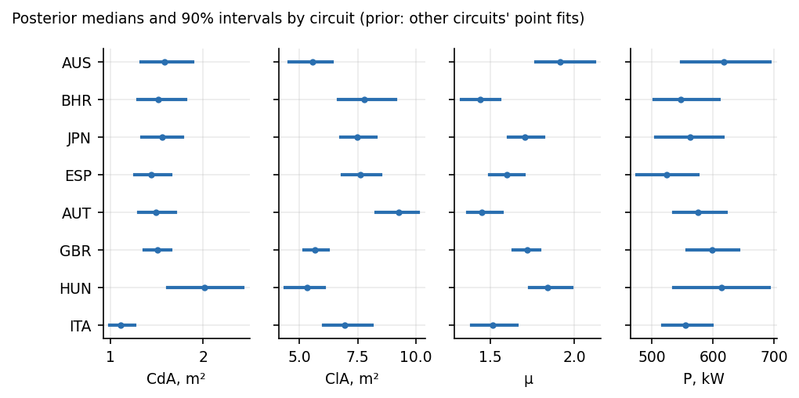
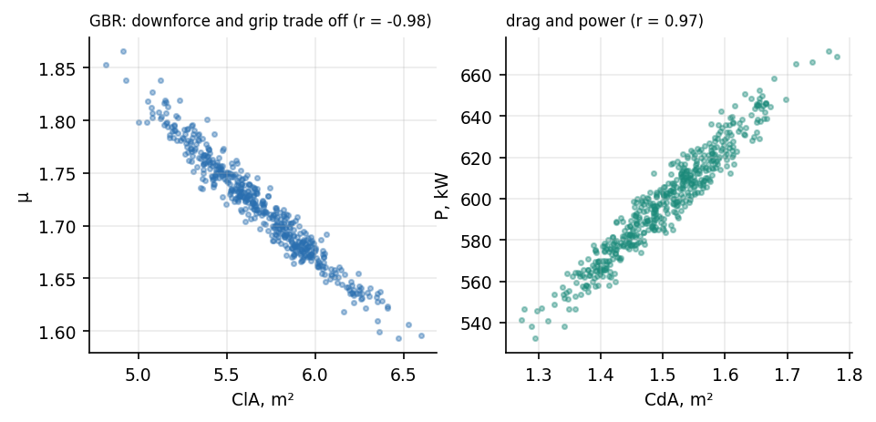

# 6. Bayesian posteriors and what they can and cannot say

I sampled the posterior of (CdA, ClA, μ, P) with NUTS in NumPyro, two chains of 250 draws each after 200 warm-up, for 8 of the 12 circuits (BHR, ESP, GBR, HUN, ITA, JPN, AUT, AUS). The other 4 (BEL, NED, USA, ABU) were not run: I stopped the job to save time, so this section covers 8 circuits, not 12. The prior for a circuit is log-normal with the mean and standard deviation (floored at 0.2) of the log point-fits of the *other* circuits: an empirical-Bayes choice. A fully hierarchical model over all 12 circuits was tried first; it cost 0.1 s per gradient and about 45 minutes per chain, so I did not run it. The likelihood is the thinned speed trace of the pole lap with a learned scale σ_v and the lap times of the three fastest laps with a learned scale σ_t. The maximum tree depth was 10 for AUS, BHR, ESP, GBR, HUN and ITA and 8 for JPN and AUT (the first attempt at JPN had not finished after 15 minutes).

**Sampler health.** JPN did not mix (R-hat 1.06, effective sample size 13) and its posterior should be disregarded; the other 7 have R-hat at most 1.03 and effective sample size at least 96. Across all 8 there were 47 divergent transitions in 4000 draws (24 at most in one circuit). Effective sample sizes of about 100 to 250 are modest, so the intervals are indicative, not precise.

**What the posteriors say.** ClA and μ are almost perfectly anti-correlated (correlation of logs -0.98, range -0.99 to -0.98): the data fix a combination of downforce and grip and not the two separately, which is the practical meaning of "effective parameters". The posterior medians of ClA run from 5.3 to 9.3 m², above the 7 m² bound used in the point fits at several circuits (the prior comes from point fits that sit on that bound). I would not read those values as physical downforce. The 90% intervals on ClA are 18% to 33% of the median wide, which is narrow compared with the spread between circuits and therefore overstates what the data know (see the next paragraph).

**Is the interval honest?** Only partly. Each posterior predicts the lap times of laps 4 and 5 of the five fastest (parameter uncertainty plus the learned σ_t), which it never saw. Across 16 held-out laps (8 circuits, two laps each) the nominal 90% interval contained the observed time 88% of the time (the misses are both laps at JPN, the circuit that did not mix) and the nominal 50% interval only 19%. The 50% result is poor and has a clear cause: the laps are ordered fastest first, so laps 4 and 5 are slower than the laps used for training, and the observed time lies above the predictive median in 16 of 16 cases. The interval is centred on the pole-lap pace and is not widened for that offset. The mean 90% width is 1.65 s, of which parameter uncertainty alone is 0.73 s. The speed residuals are strongly autocorrelated, so the likelihood overstates the information; 16 laps is a small test and the coverage figures carry wide sampling error.
